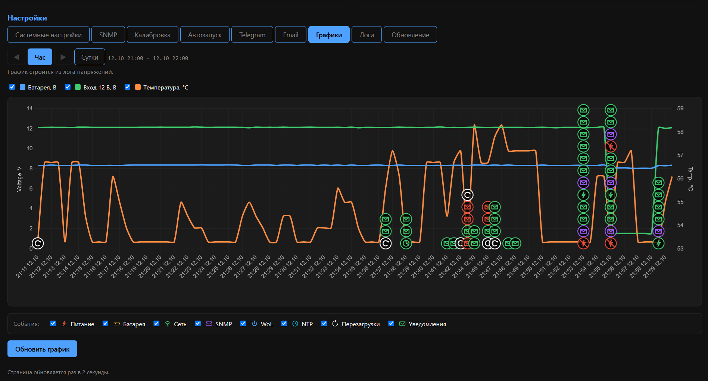
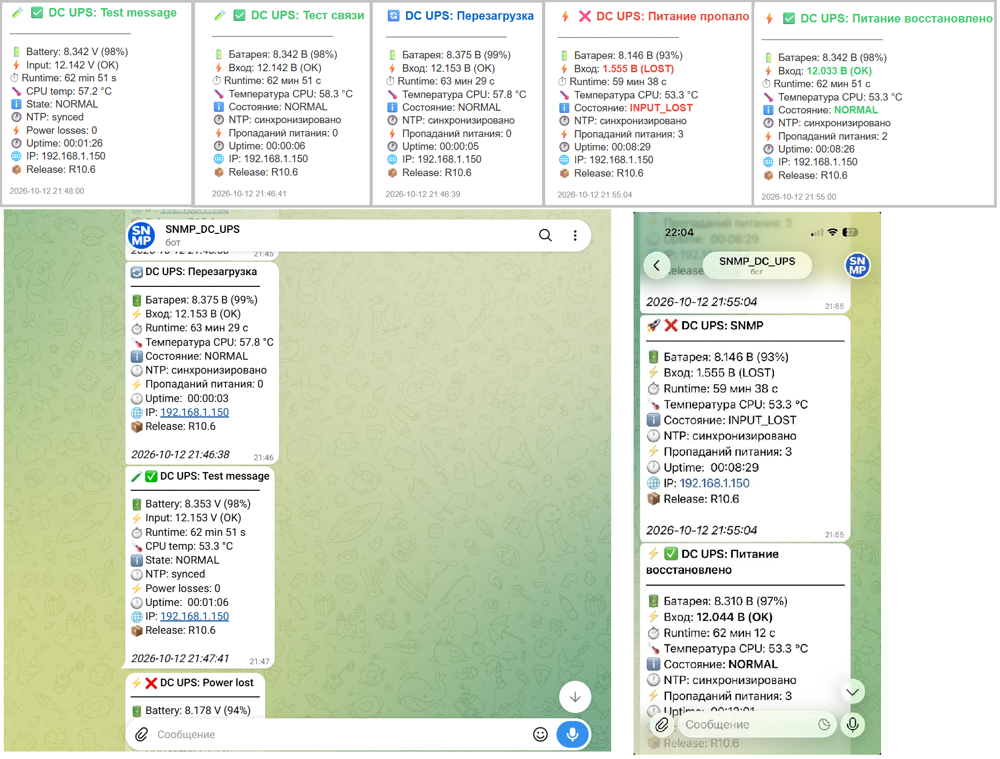
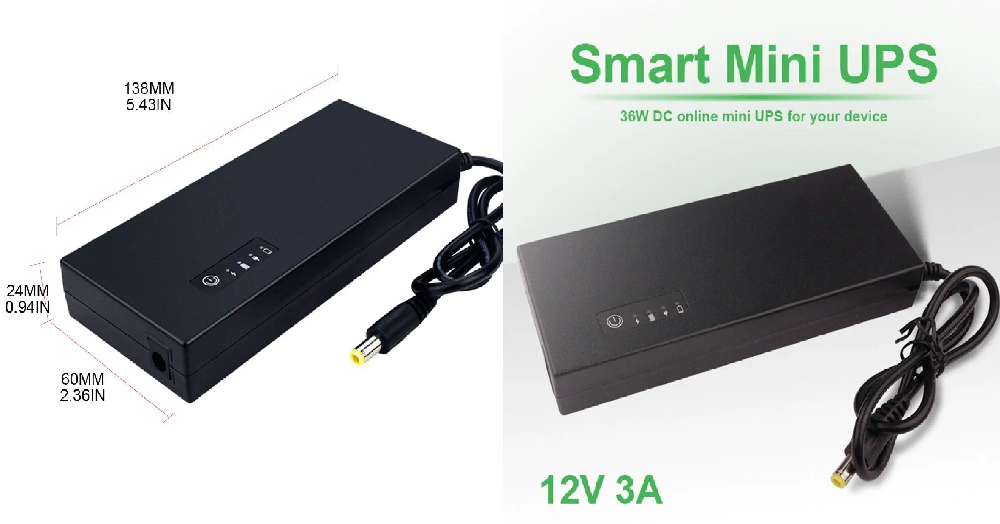
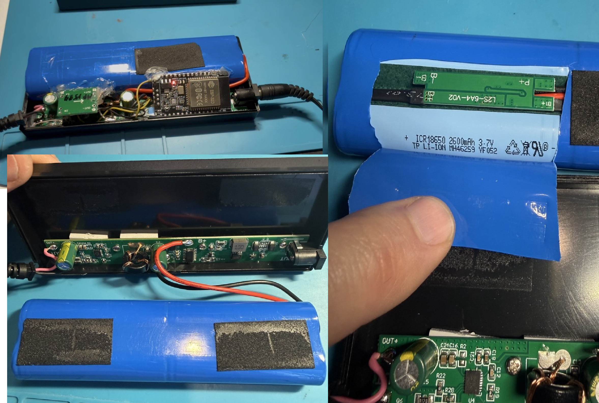
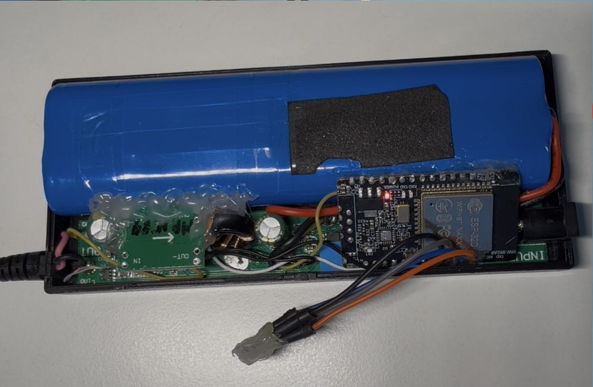
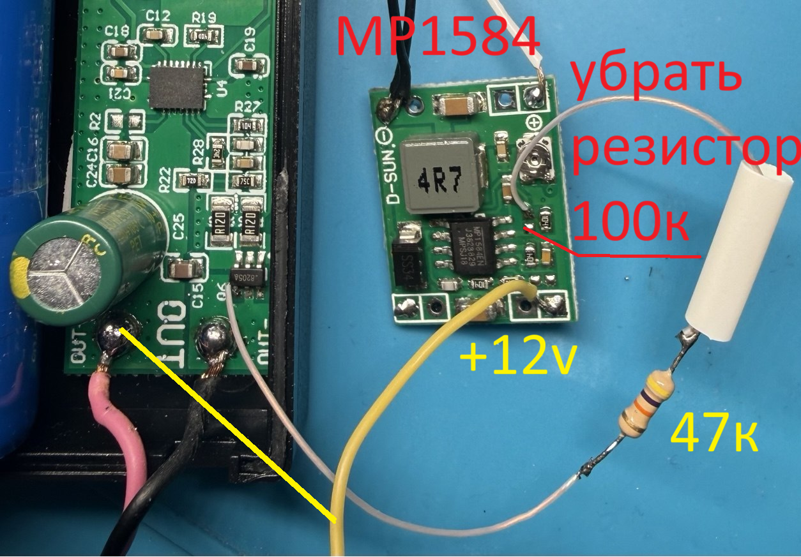
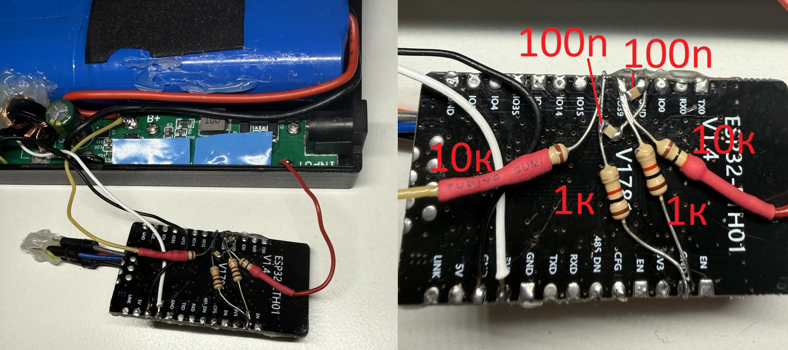
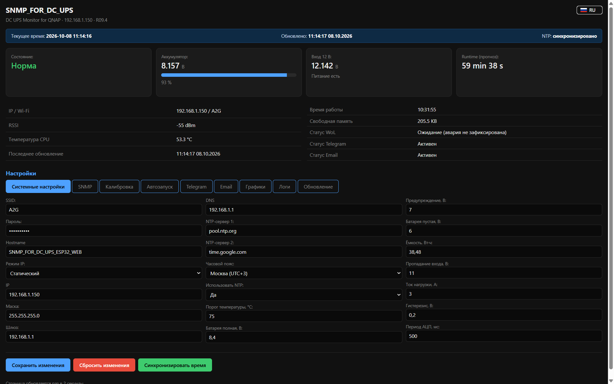
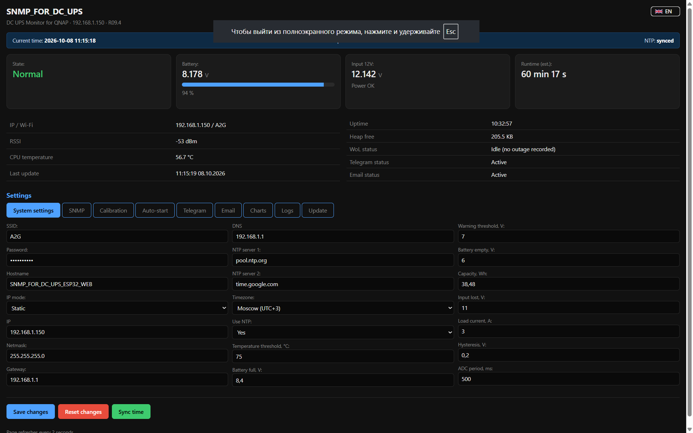

# SNMP_FOR_DC_UPS

> Готовый SNMP-агент, с веб-дашбордом и уведомлениями для модернизации DC UPS 12В 3А роутера/сервера.

[]()
[]()
[](LICENSE)
[](https://youtu.be/xlYLajyg3V0)

🎬 **Видео по проекту:** [Основное видео](https://youtu.be/xlYLajyg3V0) · [Плейлист](https://www.youtube.com/playlist?list=PLHQahsdlvSlE)

---

## 🚀 Быстрый старт (5 минут)

**Что это?** Прошивка для платы ESP32, которая превращает обычный
**DC UPS 12 В для роутера** (38,48 Вт·ч, сборка 2S2P Li-ion 18650,
разъём DC 5.5 × 2.1 мм) в сетевой SNMP-ИБП. Устройство измеряет
напряжение аккумулятора и входа, отдаёт данные по SNMP, чтобы сервер
QNAP NAS корректно выключался при аварии питания, и присылает
уведомления в Telegram/Email.

**Что нужно:**

| Компонент | Где взять |
|-----------|-----------|
| DC UPS 12 В для роутера (38,48 Вт·ч, 2S2P) | AliExpress, Ozon |
| ESP32-ETH01 v1.4 | AliExpress, Ozon |
| DC-DC 12 В → 5 В (MP1584EN или совместимый) | AliExpress, Ozon |
| 2 × резистор 1,0 кОм (1%) | для делителей напряжения |
| 2 × резистор 10 кОм (1%) | для делителей напряжения |
| 1 × резистор 47 кОм (1%) | управление DC-DC от мосфета 8502А |

**Что сделать (краткая версия):**

1. Установить **Arduino IDE 1.8.19** и **ESP32 core 2.0.17** через Boards Manager.
2. Установить библиотеки: **ElegantOTA**, **SNMP_Agent**, **UniversalTelegramBot 1.3.0**, **ArduinoJson 6.21.5**.
3. **Заполнить `config.h`** — обязательно указать **SSID и пароль Wi-Fi**, иначе устройство не подключится к сети и веб-дашборд будет недоступен. Также задать OTA-пароль (см. предупреждение ниже).
4. Создать файл `custom_ups.csv` в папке с ESP32 core (путь ниже).
5. Дописать 3 строки в `boards.txt` (путь ниже).
6. Перезапустить Arduino IDE, выбрать плату **ESP32 Dev Module** и схему **Custom UPS**.
7. Открыть `SNMP_UPS_ESP32_WEB.ino`, скомпилировать, прошить.
8. Открыть веб-дашборд `http://192.168.1.150`, ввести остальные настройки (QNAP IP, Telegram, Email, время NTP).

**Куда положить `custom_ups.csv` и куда дописать `boards.txt`?** → [см. раздел «Настройка схемы разделов»](#настройка-схемы-разделов-важно) ниже.

**Что делать после прошивки?** → [раздел «Первый запуск»](#первый-запуск).

> ⚠️ **Обратите внимание:** OTA-логин и пароль **не хранятся в NVS** — они
> берутся из `config.h` при каждой прошивке. Подробнее — в разделе
> [«Первый запуск»](#первый-запуск).

---

### Пример графиков из веб-дашборда



*График напряжений и температуры с маркерами событий: пропадание входа,
восстановление питания, NTP-синхронизация, уведомления. Навигация по времени
кнопками **Час / Сутки** и стрелками **◄ ►**.*

### Пример уведомлений в Email и Telegram



*Оформление уведомлений: эмодзи категории события, индикатор результата ✅/❌,
блок из 10 строк, подсветка строк события, тонкий разделитель.*

---

## 📋 Содержание

- [Быстрый старт](#-быстрый-старт-5-минут)
- [Возможности](#возможности)
- [Аппаратная часть](#аппаратная-часть)
- [Программная часть](#программная-часть)
  - [Требования](#требования)
  - [Установка ESP32 core](#установка-esp32-core)
  - [Установка библиотек](#установка-библиотек)
  - [Настройка схемы разделов (важно!)](#настройка-схемы-разделов-важно)
  - [Параметры сборки](#параметры-сборки)
- [Первый запуск](#первый-запуск)
- [Интеграция с QNAP](#интеграция-с-qnap)
- [Веб-дашборд](#веб-дашборд)
- [Логика работы](#логика-работы)
- [Настройка NTP](#настройка-ntp)
- [Уведомления](#уведомления)
- [Структура проекта](#структура-проекта)
- [API-эндпоинты](#api-эндпоинты)
- [Приватные OID](#приватные-oid)
- [Видео](#видео)
- [Известные ограничения](#известные-ограничения)
- [Лицензия](#лицензия)

---

## Возможности

- **Измерение:** напряжение аккумулятора (2S2P Li-ion 18650), вход 12 В,
  остаточный заряд по нелинейной кривой, прогноз runtime, температура кристалла ESP32.
- **SNMP-агент:** стандартный UPS MIB (RFC 1628) + приватная ветка,
  GET/WALK, INFORM/TRAP. Совместим с QNAP QTS 5.2.
- **Веб-дашборд:** 9 вкладок, двуязычный (RU/EN), графики с маркерами событий,
  встроенный журнал с двухфайловой ротацией.
- **Уведомления:** Telegram (Bot API), Email (SMTP/SSL, Mail.ru по умолчанию).
  Гибкая фильтрация по 8 категориям событий. **Единый формат для всех
  уведомлений — 10 строк** (R10.6). Локализация RU/EN по языку дашборда.
- **Boot-отчёт:** при каждой перезагрузке отправляется полный отчёт
  в TG и EM безусловно (без маски событий), через 3 секунды после старта (R10.6).
- **Wake-on-LAN:** автозапуск QNAP по трём условиям.
- **OTA:** обновление прошивки по воздуху.
- **NTP:** окно синхронизации 1 час, до 3 попыток с интервалом 30 мин.
- **Стабильные показания ADC:** медиана 15 значений + EMA-сглаживание.
  Разброс ±10 мВ (R10.8).

---

## Аппаратная часть

### ИБП (DC UPS для роутера)

Проект рассчитан на использование готового **DC UPS 12 В для роутера** —
у таких устройств обычно нет конкретной модели, только технические
характеристики.

**Технические характеристики:**

| Параметр | Значение |
|----------|----------|
| Назначение | DC UPS для роутера / видеонаблюдения |
| Вход / Выход | DC 12 В |
| Разъём | DC 5.5 × 2.1 мм |
| Ёмкость | 38,48 Вт·ч |
| Тип батареи | Li-ion 18650, сборка **2S2P** (4 ячейки — 2 последовательно, 2 параллельно) |
| Номинал батареи | 7,4 В (2S), удвоенная ёмкость (2P) |
| Размеры | 144,22 × 59,23 × 31,03 мм |

**Внешний вид:**





**Размещение плат внутри ИБП:**



Внутрь такого корпуса устанавливается плата ESP32-ETH01 v1.4 с делителями
напряжения — она и превращает обычный DC UPS в сетевой SNMP-ИБП.

### Состав

- DC UPS 12 В для роутера (38,48 Вт·ч, 2S2P) — 1 шт.
- ESP32-ETH01 v1.4 — 1 шт.
- Понижающий DC-DC преобразователь MP1584EN (12 В → 5 В) — 1 шт.
- Делитель для канала батареи: **1,0 кОм + 10 кОм (1%)** — 1 комплект.
- Делитель для канала входа: **1,0 кОм + 10 кОм (1%)** — 1 комплект.
- Резистор **47 кОм (1%)** — управление DC-DC от затвора мосфета 8502А — 1 шт.
- Провода, разъёмы, корпус (для ESP32) — по необходимости.

> ⚠️ **R10.7:** Номиналы делителей изменены с 4,6 кОм + 47 кОм на
> **1,0 кОм + 10 кОм**. Это снижает импеданс источника (Rист) с 4,2 кОм
> до 0,91 кОм, что значительно лучше для ADC ESP32 (рекомендуется ≤ 2,5 кОм).
> **После смены номиналов требуется перекалибровка обоих каналов!**

### ⚠️ Особенности подключения DC-DC преобразователя

Выход DC UPS отключается **не по плюсовому выводу, а по минусовому** —
через спаренный мосфет 8502А. Это накладывает особенности на схему
подключения понижающего DC-DC преобразователя.

**Схема питания DC-DC:**

- **Минус** питания DC-DC берётся **от минуса аккумулятора**,
  **не** от выхода ИБП.
- **Плюс** — непосредственно **с выхода ИБП**.
- **Управление** — через резистор **47 кОм** с затвора спаренного
  мосфета 8502А.

**Зачем именно так:**

Если запитать DC-DC от аккумулятора напрямую (плюс и минус с АКБ),
то при саморазряде до 8 В ИБП автоматически включает режим подзарядки.
Преобразователь при этом будет постоянно разряжать-заряжать
аккумулятор — это быстро выводит его из строя. Схема с питанием
от выхода ИБП этой проблемы не имеет.

**Важно про MP1584EN:**

Управляющая ножка (pin 2 микросхемы MP1584 на плате) **уже подтянута
резистором 100 кОм к плюсу питания**. Этот резистор **надо удалить**,
а в освободившуюся точку **припаять вход управления** (сигнал
с затвора мосфета 8502А через 47 кОм).

При такой схеме DC-DC преобразователь **выключается штатной кнопкой
включения ИБП** — то есть при выключении ИБП обесточивается
и ESP32, и вся нагрузка.

**Подключение DC-DC преобразователя к выходу ИБП:**



### Схема монтажа делителей



*Схема монтажа резисторов делителей напряжения (R10.7).*

### Схема подключения

**Питание устройства:**

```
[Выход ИБП 12 В] ──> [DC-DC 12В → 5В] ──> [Вход 5V платы ESP32]
```

**Измерительные цепи:**

```
Делитель батареи:  +АКБ ── 10 кОм ──┬── IO36 ── 1,0 кОм ── GND
                                     │
                              (средняя точка)

Делитель входа:    +12 В ── 10 кОм ──┬── IO39 ── 1,0 кОм ── GND
                                     │
                              (средняя точка)
```

Коэффициент деления: `K = 1,0 / (1,0 + 10) ≈ 0,09091`

### Про конденсаторы на входах ADC

На входе ADC (IO36, IO39) можно установить керамические конденсаторы
**100 нФ** между средней точкой делителя и GND — это простой RC-фильтр
нижних частот (~160 кГц среза при 1 кОм).

**Практический результат:** установка этих конденсаторов **никак не
повлияла** на точность измерения. Дрожание показаний (±40 мВ) было
полностью устранено **программно** — медианой 15 значений и EMA-сглаживанием
(`ADC_EMA_ALPHA = 0.15`).

**Вывод:** ставить конденсаторы **не обязательно**, но **не помешает** —
они улучшают помехозащищённость при неблагоприятной ЭМ-обстановке
(например, рядом с импульсными источниками). Если места на плате хватает
и есть под рукой — можно поставить. Если нет — работать будет и без них.

### Параметры аккумулятора

| Параметр | Значение |
|----------|----------|
| Тип | Li-ion 18650, сборка **2S2P** (4 ячейки) |
| Номинальное напряжение | 7,4 В (2S) |
| Полный заряд | 8,4 В |
| «Пустая» | 6,0 В |
| Предупреждение | 7,0 В |
| BMS-отсечка | 5,0 В |
| Порог пропадания входа | 11,0 В |
| Гистерезис | 0,2 В |
| Ток нагрузки | 2 А при 12 В (по умолчанию) |
| Ёмкость | 38,48 Вт·ч |

### ⚠️ Меры безопасности

- **Не подавайте** на плату напряжение выше **5,5 В**.
- **Не подключайте** делители к источникам выше **15 В**.
- **Не подавайте** на вход DC-DC более **28 В**.
- **Соблюдайте полярность** питания — переполюсовка убивает плату.
- Перед подключением к работающему ИБП — проверьте монтаж мультиметром.
- **Обязательно удалите** резистор 100 кОм на MP1584EN
  (подтяжка pin 2 к плюсу).

---

## Программная часть

### Требования

| Компонент | Версия | Обязательно |
|-----------|--------|-------------|
| Arduino IDE | 1.8.19 | Да |
| ESP32 core | **2.0.17** | Да |
| ElegantOTA | актуальная | Да |
| SNMP_Agent | актуальная | Да |
| UniversalTelegramBot | **1.3.0** | Да |
| ArduinoJson | **6.21.5** | Да ⚠️ **НЕ 7.x** |
| mbedtls/base64.h | встроена в ESP32 core | — |

> ⚠️ **ArduinoJson 7.x несовместим** с UniversalTelegramBot 1.3.0.
> Используйте именно 6.21.5.

### Установка ESP32 core

1. Откройте Arduino IDE.
2. **Файл → Настройки** (File → Preferences).
3. В поле **«Дополнительные ссылки для менеджера плат»** добавьте:
   ```
   https://espressif.github.io/arduino-esp32/package_esp32_index.json
   ```
4. **Инструменты → Плата → Менеджер плат** (Tools → Board → Boards Manager).
5. Найдите **esp32** (от Espressif Systems).
6. Установите **версию 2.0.17** (не 3.x — код написан под 2.0.17).

### Установка библиотек

**Инструменты → Управлять библиотеками** (Tools → Manage Libraries).
Найдите и установите:

| Библиотека | Автор | Версия |
|-----------|-------|--------|
| ElegantOTA | Ayush Sharma | последняя |
| SNMP_Agent | Brice Copy | последняя |
| UniversalTelegramBot | Brian Lough | 1.3.0 |
| ArduinoJson | Benoit Blanchon | **6.21.5** |

### Настройка схемы разделов (важно!)

Проект использует **кастомную схему разделов**, чтобы приложение
занимало **1,4 МБ**, а SPIFFS — **1,2 МБ**. Без этих шагов прошивка
не поместится.

#### Шаг 1. Файл `custom_ups.csv`

**Куда положить:** в папку `partitions` установленного ESP32 core:

```
C:\Users\{ВашеИмя}\AppData\Local\Arduino15\packages\esp32\hardware\esp32\2.0.17\tools\partitions\
```

> 💡 **Как найти папку быстро:** в Arduino IDE: **Файл → Настройки** →
> внизу ссылка на папку с `preferences.txt`. Откройте её, поднимитесь
> в `Arduino15`, зайдите в `packages\esp32\hardware\esp32\2.0.17\tools\partitions\`.

**Имя файла:** `custom_ups.csv`

**Содержимое:**

```csv
# Name,   Type, SubType, Offset,   Size,     Flags
nvs,      data, nvs,     0x9000,   0x5000,
otadata,  data, ota,     0xe000,   0x2000,
app0,     app,  ota_0,   0x10000,  0x160000,
app1,     app,  ota_1,   0x170000, 0x160000,
spiffs,   data, spiffs,  0x2d0000, 0x130000,
```

> Файл можно создать прямо в блокноте и сохранить с расширением `.csv`.

#### Шаг 2. Файл `boards.txt`

**Где лежит:**

```
C:\Users\{ВашеИмя}\AppData\Local\Arduino15\packages\esp32\hardware\esp32\2.0.17\boards.txt
```

**Что сделать:** открыть файл в любом текстовом редакторе (Блокнот, Notepad++,
VS Code). **Прокрутить в самый низ** и **дописать 3 строки**:

```
esp32.menu.PartitionScheme.custom_ups=Custom UPS (1.4MB APP / 1.2MB SPIFFS)
esp32.menu.PartitionScheme.custom_ups.build.partitions=custom_ups
esp32.menu.PartitionScheme.custom_ups.upload.maximum_size=1441792
```

**Сохранить файл.**

> ⚠️ Не удаляйте существующие строки — только добавьте в конец.
> Файл `boards.txt` принадлежит ESP32 core, поэтому **не публикуется**
> в этом репозитории — его надо править вручную.

#### Шаг 3. Перезапуск и выбор схемы

1. **Закройте Arduino IDE полностью** и откройте заново.
2. **Инструменты → Плата → ESP32 Arduino → ESP32 Dev Module**.
3. **Инструменты → Partition Scheme** — в конце списка появится
   **Custom UPS (1.4MB APP / 1.2MB SPIFFS)**. Выберите его.

> ⚠️ **Важно:** при обновлении пакета ESP32 через Boards Manager
> изменения в `boards.txt` **сотрутся**. Придётся дописывать заново.
> Файл `custom_ups.csv` тоже может исчезнуть.

### Параметры сборки

Установите в Arduino IDE:

| Параметр | Значение |
|----------|----------|
| Board | ESP32 Dev Module |
| Partition Scheme | **Custom UPS (1.4MB APP / 1.2MB SPIFFS)** |
| Flash Size | 4MB (32Mb) |
| Upload Speed | 921600 |
| CPU Frequency | 240MHz (WiFi/BT) |
| Flash Frequency | 80MHz |
| Flash Mode | QIO |
| PSRAM | Disabled |
| Arduino Runs On | Core 1 |
| Events Run On | Core 1 |

---

## Первый запуск

### 1. Заполните `config.h` перед прошивкой

Файл `config.h` содержит **дефолтные** значения, которые применяются,
если в NVS ещё нет сохранённых настроек (то есть при первом запуске).

**Обязательно заполнить перед прошивкой:**

```c
#define WIFI_SSID_DEFAULT    "ВашSSID"
#define WIFI_PASS_DEFAULT    "ВашПароль"
```

> ⚠️ **Если не заполнить Wi-Fi SSID и пароль** — устройство после прошивки
> **не подключится к сети**, и веб-дашборд по адресу `http://192.168.1.150`
> будет **недоступен**. Режима точки доступа (AP) в текущей прошивке нет —
> устройство работает только как Wi-Fi-клиент (STA). Заполнить `config.h`
> и перепрошить придётся через USB.

**Также задайте OTA-пароль** (для последующих обновлений по воздуху):

```c
#define OTA_PASSWORD         "ВашOTAPassword"
```

> ⚠️ **ВАЖНО про OTA-пароль.** В отличие от Wi-Fi, настроек QNAP, Telegram и Email,
> **OTA-логин и пароль НЕ хранятся в NVS** — они берутся напрямую из `config.h`
> **при каждой прошивке**. Это значит:
>
> - Если вы прошили версию с заглушкой (`CHANGE_ME`), OTA-пароль на устройстве
>   станет `CHANGE_ME` **до следующей прошивки**.
> - Ваши реальные настройки (Wi-Fi, QNAP, TG, EM) при этом **остаются в NVS** —
>   их прошивка не затрагивает.
> - **Публичный `config.h` из GitHub** (с заглушками) **не прошивайте на устройство**,
>   если не хотите каждый раз менять пароль OTA. Держите локальную копию с реальными
>   значениями.
>
> В текущей публичной версии **по умолчанию**:
> - Логин: `admin`
> - Пароль: `CHANGE_ME`

**Остальные параметры** (IP, маска, шлюз, QNAP IP, Telegram Bot Token,
Email SMTP, время NTP) можно оставить по умолчанию и ввести позже через веб-дашборд.

> ⚠️ **Не публикуйте свои реальные пароли** в открытый репозиторий GitHub.
> В публичной версии `config.h` должны быть заглушки (`YOUR_WIFI_SSID`,
> `CHANGE_ME`). Свои реальные значения вписывайте только в **локальную**
> копию файла перед сборкой.

### 2. Прошейте прошивку

**Через USB (первый раз):**

1. Подключите ESP32-ETH01 к компьютеру через USB-UART переходник.
2. В Arduino IDE выберите **Порт**.
3. Нажмите **Загрузить** (Upload).

**По воздуху (OTA, для последующих обновлений):**

1. Откройте в браузере `http://192.168.1.150/update`.
2. Логин: `admin`, пароль — **из `config.h`** (в публичной версии `CHANGE_ME`).
3. Загрузите файл `.ino.bin`.

> ⚠️ **OTA-пароль не хранится в NVS.** Он всегда берётся из `config.h`
> при прошивке. Если вы залили версию с заглушкой — пароль стал `CHANGE_ME`.
> Чтобы вернуть свой, отредактируйте `config.h` локально, пересоберите и
> прошейте ещё раз (введя текущий пароль).
>
> **Ваши остальные настройки (Wi-Fi, QNAP, TG, EM) при этом НЕ теряются** —
> они хранятся в NVS и сохраняются между прошивками.

### 3. Откройте веб-дашборд

В браузере: **`http://192.168.1.150`**

**Если устройство не подключилось к Wi-Fi:**

- Проверьте `config.h` — правильно ли указаны `WIFI_SSID_DEFAULT`
  и `WIFI_PASS_DEFAULT`.
- Подключите плату по USB и откройте **Serial Monitor** в Arduino IDE —
  там видно, пытается ли устройство подключиться к сети и какая ошибка.
- Перепрошейте устройство с корректными данными.

> 💡 В текущей версии **режима точки доступа (AP) нет**. Устройство сразу
> пытается подключиться к заданной сети. Если SSID/пароль неверные —
> подключения не будет.

### 4. Заполните настройки

**Обязательно:**

- **Системные настройки:** IP/маска/шлюз, NTP-серверы, часовой пояс, время начала окна NTP-синхронизации.
- **SNMP:** IP QNAP, MAC QNAP (для WoL), community.
- **Калибровка:** измерьте мультиметром реальное напряжение АКБ и входа,
  введите значения, нажмите **«Рассчитать gain»** для каждого канала.

> ⚠️ **R10.7+:** если менялись номиналы делителей (например, с 4,6+47 на
> 1,0+10 кОм), обязательно выполните **перекалибровку** обоих каналов —
> старые значения gain в NVS не подходят.

**Опционально:**

- **Telegram:** Bot Token, Chat ID, категории событий.
- **Email:** SMTP-хост, порт, логин, пароль приложения, From, To.
- **Автозапуск:** параметры WoL.

После заполнения — **«Сохранить изменения»** на любой вкладке. Устройство
перезагрузится и применит настройки.

---

## Интеграция с QNAP

В **QTS**:

1. **Панель управления → Система → Внешние устройства → UPS**.
2. Выбрать **SNMP-подключение**.
3. **IP:** адрес устройства (например, `192.168.1.150`).
4. **Community:** `public` (или ваш из настроек SNMP).
5. Настроить реакцию на пропадание питания.
6. Сохранить.

**Что увидит QNAP:**

- Производитель: `Ganc777`
- Модель: `ESP32-ETH01 v1.4 DC UPS Monitor`
- Состояние: «Нормальное» / «Аварийное»
- Ёмкость батареи: %
- Приблизительное время защиты: HH:MM:SS

---

## Веб-дашборд

### Главный экран

На главном экране — состояние ИБП, напряжение АКБ и входа, прогноз
runtime, температура CPU, IP/RSSI, uptime, свободная память, статусы
WoL/Telegram/Email.

### Графики


График напряжений и температуры с маркерами событий (молния — пропадание
входа, часы — NTP-синхронизация, конверт — SNMP/Telegram/Email, и т.д.).
Навигация по времени: **◄ ►** вокруг активной кнопки **Час / Сутки**.

### Системные настройки

**Русский интерфейс:**



**English interface:**



Настройки Wi-Fi, сети, NTP, пороги UPS, параметры АКБ, период АЦП.
Двуязычный интерфейс — переключатель **RU / EN** в правом верхнем углу.
Выбранный язык влияет на все уведомления TG/EM.

### Вкладки

| Вкладка | Назначение |
|---------|-----------|
| **Системные настройки** | Wi-Fi, сеть, NTP, пороги UPS, калибровка порогов |
| **SNMP** | IP QNAP, MAC, community, порт, тип уведомлений, OID |
| **Калибровка** | Ввод реальных напряжений, расчёт gain |
| **Автозапуск** | Wake-on-LAN: условия срабатывания |
| **Telegram** | Токен, Chat ID, категории событий, периодический отчёт |
| **Email** | SMTP-настройки, категории событий, периодический отчёт |
| **Графики** | Напряжения и температура, маркеры событий, навигация ◄ ► |
| **Логи** | Журнал событий, настройка периода записи |
| **Обновление** | OTA-обновление прошивки |

---

## Логика работы

### Состояния устройства

| Состояние | Условие |
|-----------|---------|
| **NORMAL** | Вход есть, батарея в норме |
| **INPUT_LOST** | Вход пропал, работа от батареи |
| **LOW_BATT** | Заряд ниже порога предупреждения (7,0 В) |
| **CRITICAL** | Заряд ниже порога «пустая» (6,0 В) |

### Расчёт заряда

Используется **нелинейная кривая разряда Li-ion** с плато 7,2–7,6 В
и резким спадом ниже 7,0 В.

### Расчёт runtime

```
E_остаток (Вт·ч) = Ёмкость × Заряд / 100
P_нагрузки (Вт)  = Ток нагрузки × 12 В
runtime (ч)      = E_остаток / P_нагрузки
```

### Фильтрация ADC (R10.8)

Показания АЦП обрабатываются **двухступенчато**:

1. **Медиана 15 значений** — убирает короткие импульсные выбросы
   (Wi-Fi-пакеты, переключение DC-DC). Медиана устойчива к единичным
   выбросам: даже если 1–2 выборки из 15 «улетели», результат не изменится.

2. **EMA (экспоненциальное сглаживание)** — убирает медленный шум.
   `ema = α × median + (1 - α) × ema_prev`, где `α = 0.15`.

**Результат:**
- Разброс показаний снижен с **±40 мВ** до **±10 мВ**.
- Реакция на реальное изменение напряжения — **~3 секунды**
  (постоянная времени EMA).

Параметр `ADC_EMA_ALPHA` в `config.h`:
- `0.10` — сильное сглаживание, реакция ~5 сек, разброс ±5 мВ.
- `0.15` — **оптимум** (по умолчанию).
- `0.25` — слабое сглаживание, реакция ~1,5 сек, разброс ±15 мВ.

### Wake-on-LAN

Пакет WoL отправляется, когда **одновременно** выполнено:

1. Было пропадание входа **≥ 600 сек**.
2. После восстановления питание стабильно **≥ 300 сек**.
3. Заряд АКБ **≥ 70%**.

Пакет отправляется **один раз за цикл аварии**.

---

## Настройка NTP

Прошивка поддерживает настраиваемое окно плановой синхронизации NTP.

### Как работает

- **NTP всегда включён.**
- Раз в сутки устройство выполняет **плановую синхронизацию** в окне **1 час**.
- **Время начала окна** задаётся в дашборде (вкладка **Системные настройки**):
  - **Час** (0–23) и **Минуты** (шаг 5: 00, 05, 10, …, 55).
  - По умолчанию — **11:30** (окно 11:30–12:29).
- Внутри окна — до **3 попыток** синхронизации с интервалом **30 минут**.
  Третья попытка может выйти за границу окна — это допустимо.
- Успех на любой попытке — прекращает серию до следующих суток.
- **Ручная синхронизация** доступна всегда — кнопка
  **«Синхронизировать время»** на вкладке **Системные настройки**.

### Логи

Плановая синхронизация:

```
[EVT] NTP synced (sched, 1/3)
[EVT] NTP FAILED (sched, 1/3)
[EVT] NTP synced (sched, 3/3)
[EVT] NTP FAILED (sched, 3/3)
```

**Ручная** синхронизация:

```
[EVT] NTP synced (manual)
[EVT] NTP FAILED (manual)
```

**При загрузке** (если время ещё не установлено):

```
[EVT] NTP synced (init)
[EVT] NTP FAILED (init)
```

### Что означают иконки на графике

- **Зелёные часы** — успешная синхронизация.
- **Красные часы** — неудачная синхронизация.

### ⚠️ Важно

- **Окно не может пересекать полночь.** Если поставить начало окна в 23:30,
  оно обрезается до 23:59 (30 минут). Полный час работает только для
  начала окна не позднее 22:59.

---

## Уведомления

### Категории событий

| Категория | Маска | Источник | Эмодзи |
|-----------|-------|----------|--------|
| Питание | 0x0001 | STATE →, INPUT LOST/RESTORED | ⚡ |
| Батарея | 0x0002 | LOW_BATT, CRITICAL | 🔋 |
| WoL | 0x0004 | WoL sent | ⏻ |
| Перезагрузки | 0x0008 | boot | 🔄 |
| Wi-Fi | 0x0010 | WiFi connected/lost | 📶 |
| SNMP | 0x0020 | SNMP event sent | 🚀 |
| NTP | 0x0040 | NTP synced / FAILED | 🕐 |
| Температура | 0x0080 | TEMP_HIGH, TEMP_OK | 🌡️ |

### Единый формат — 10 строк (R10.6)

**Все уведомления** (событие, периодический отчёт, boot-отчёт, тест)
имеют **одинаковую структуру** — 10 строк под разделителем:

| № | Строка | Эмодзи |
|---|--------|--------|
| 1 | Батарея: X.XXX В (NN%) | 🔋 |
| 2 | Вход: X.XXX В (OK/LOST) | ⚡ |
| 3 | Runtime: NN мин NN с | ⏱ |
| 4 | Температура CPU: XX.X °C | 🌡️ |
| 5 | Состояние: NORMAL/INPUT_LOST/... | ℹ️ |
| 6 | NTP: синхронизировано / не синхронизировано | 🕐 |
| 7 | Пропаданий питания: N | ⚡ |
| 8 | Uptime: Xd HH:MM:SS | 🕐 |
| 9 | IP: 192.168.1.150 | 🌐 |
| 10 | Release: RXX.X | 📦 |

### Заголовки

| Тип | Заголовок |
|-----|-----------|
| Событие | `<эмодзи категории> <✅/❌> DC UPS: <Заголовок события>` |
| Периодический отчёт | `📊 DC UPS: Периодический отчёт` |
| Boot-отчёт | `🔄 DC UPS: Перезагрузка` |
| Тест | `🧪 ✅ DC UPS: Тест связи` |

**Подсветка:** строки, относящиеся к событию, выделяются:
- **Telegram** — жирным (`<b>`).
- **Email** — цветом (красный при ❌, зелёный при ✅).

Например, для события «Питание пропало» подсвечиваются строки 2 (Вход) и 5 (Состояние).

### Boot-отчёт (R10.6)

При **каждой перезагрузке** устройства:
- Отправляется **безусловно** (не подчиняется маске событий).
- **Через 3 секунды** после старта (нужно для стабилизации ADC и Wi-Fi).
- Заголовок: `🔄 DC UPS: Перезагрузка` / `🔄 DC UPS: Reboot`.
- Тело — те же 10 строк.
- Счётчик пропаданий питания сбрасывается.

### Периодический отчёт

Отправляется **в 12:00** локального времени (фиксированно):

- **День** — каждый день.
- **Неделя** — по понедельникам.
- **Месяц** — 1-го числа.

Счётчик пропаданий питания сбрасывается после отправки.

> ℹ️ Время периодических отчётов **не привязано** к времени NTP-синхронизации.

**Пример уведомлений в Email и Telegram:**


---

## Структура проекта

```
SNMP_FOR_DC_UPS/
├── SNMP_UPS_ESP32_WEB.ino    # Главный скетч
├── config.h                   # Дефолты (с заглушками для GitHub)
├── storage.h / storage.cpp    # Загрузка/сохранение настроек в NVS
├── adc.h / adc.cpp            # Чтение АЦП: медиана 15 + EMA
├── ups.h / ups.cpp            # Логика ИБП, единое тело из 10 строк
├── wifi.h / wifi.cpp          # Wi-Fi подключение, переподключение
├── ntp.h / ntp.cpp            # Синхронизация времени (до 3 попыток)
├── snmp.h / snmp.cpp          # SNMP-агент, UPS MIB, приватные OID
├── logger.h / logger.cpp      # Логирование, локализация, парсеры
├── telegram.h / telegram.cpp  # Уведомления в Telegram
├── email.h / email.cpp        # Уведомления по Email (SMTP)
├── wol.h / wol.cpp            # Wake-on-LAN
├── web.h / web.cpp            # Веб-сервер, дашборд, API
├── system.h / system.cpp      # Утилиты, температура, uptime
├── debug.h / debug.cpp        # Отладочный вывод в UART
├── custom_ups.csv             # Схема разделов (копия для справки)
├── README.md                  # Этот файл
├── LICENSE                    # MIT
├── .gitignore                 # Исключения для Git
└── docs/
    ├── dashboard1.png         # Скриншот графиков
    ├── dashboard2.png         # Системные настройки (RU)
    ├── dashboard3.png         # Системные настройки (EN)
    ├── UPS1.png               # Фото DC UPS (вид 1)
    ├── UPS2.png               # Фото DC UPS (вид 2)
    ├── UPS3.png               # Пример уведомлений Email/Telegram
    ├── UPS4.png               # Подключение DC-DC преобразователя
    ├── UPS5.png               # Размещение плат внутри ИБП
    └── UPS6.png               # Схема монтажа делителей напряжения
```

> `custom_ups.csv` в репозитории — **только для справки**. Его нужно
> скопировать в системную папку ESP32 core (см. раздел выше).
> `boards.txt` в репозиторий **не входит** — правится вручную.

### Приоритеты инициализации

```
debugInit → storageLoad → storageDump → adcInit → upsInit
→ wifiInit (+ ожидание 15 сек) → ntpInit (ставит TZ)
→ loggerInit → snmpInit → wolInit → webInit
→ telegramInit → emailInit
```

---

## API-эндпоинты

| Метод | Путь | Назначение |
|-------|------|-----------|
| GET | `/` | Веб-дашборд |
| GET | `/api/status` | JSON статуса |
| GET/POST | `/api/config` | Чтение/запись конфига |
| POST | `/api/ui_config` | UI-настройки (язык, маска событий) |
| POST | `/api/log_config` | Период записи лога |
| POST | `/api/config_reset_pane` | Сброс панели настроек |
| GET | `/api/reboot` | Перезагрузка |
| POST | `/api/ntp_sync` | Синхронизация NTP |
| POST | `/api/calibrate` | Калибровка канала |
| POST | `/api/calibrate_reset` | Сброс калибровки |
| POST | `/api/wol_manual` | Ручная отправка WoL |
| POST | `/api/telegram_test` | Тест Telegram |
| POST | `/api/email_test` | Тест Email |
| GET | `/api/log` | Отдача лога |
| GET | `/api/log_download` | Скачать лог |
| POST | `/api/log_clear` | Очистить лог |
| GET | `/update` | ElegantOTA |

---

## Приватные OID

**Корневая ветка:** `.1.3.6.1.4.1.99999.1`

| Суффикс | Назначение |
|---------|-----------|
| `.1.0` | Напряжение батареи, мВ |
| `.2.0` | Напряжение входа, мВ |
| `.3.0` | Наличие входа (0/1) |
| `.4.0` | Батарея ниже warn (0/1) |
| `.5.0` | Батарея критически разряжена (0/1) |
| `.6.0` | Runtime, сек |
| `.7.0` | Uptime, сек |
| `.8.0` | Код состояния (0–3) |
| `.9.0` | Код последнего события |

**Коды состояния:** `0=NORMAL, 1=INPUT_LOST, 2=LOW_BATT, 3=CRITICAL`

**Коды событий:** `0=нет, 1=INPUT_LOST, 2=INPUT_RESTORED, 3=BATT_LOW,
4=BATT_CRITICAL, 5=BATT_RECOVERED`

### Стандартные OID (RFC 1628)

| OID | Назначение |
|-----|-----------|
| `.1.3.6.1.2.1.33.1.1.1.0` | upsIdentManufacturer |
| `.1.3.6.1.2.1.33.1.1.2.0` | upsIdentModel |
| `.1.3.6.1.2.1.33.1.2.1.0` | upsBatteryStatus |
| `.1.3.6.1.2.1.33.1.2.2.0` | upsSecondsOnBattery |
| `.1.3.6.1.2.1.33.1.2.3.0` | upsEstimatedMinutesRemaining |
| `.1.3.6.1.2.1.33.1.2.4.0` | upsEstimatedChargeRemaining |
| `.1.3.6.1.2.1.33.1.3.3.1.5.1` | upsInputVoltage |
| `.1.3.6.1.2.1.33.1.4.1.0` | upsOutputSource |
| `.1.3.6.1.2.1.33.1.4.2.0` | upsAlarmsPresent |

---

## Видео

Пошаговая сборка, настройка и демонстрация работы — на YouTube:

🎬 **Основное видео:** [SNMP_FOR_DC_UPS — обзор](https://youtu.be/xlYLajyg3V0)

📺 **Плейлист по проекту:** [SNMP_FOR_DC_UPS (полный цикл)](https://www.youtube.com/playlist?list=PLHQahsdlvSlE)

---

## Известные ограничения

- **Uptime** сбрасывается на 0 после ~49,7 суток (переполнение `millis()`).
- После переключения режима лога **«только события» → любой другой период**
  нужна перезагрузка.
- **NTP:** окно 1 час, до 3 попыток с интервалом 30 мин. Окно не может
  пересекать полночь.
- **Периодические отчёты** TG/EM в **12:00** (фиксированно). Если устройство
  перезагрузилось после 12:00 — отчёт в этот день не отправляется, но
  отправляется **boot-отчёт** (10 строк, 🔄).
- **Счётчик пропаданий питания** хранится в RAM и **теряется при перезагрузке**
  (это правильно — boot-отчёт сбрасывает счётчик на 0).
- **Иконки событий на графике** выстраиваются в столбик с шагом 26 px.
- **Режима точки доступа (AP) нет.** Если Wi-Fi SSID/пароль в `config.h`
  неверные — устройство не подключится, потребуется USB-перепрошивка.
- **OTA-пароль не хранится в NVS.** Он берётся из `config.h` при каждой
  прошивке. Если прошита версия с заглушкой — пароль `CHANGE_ME`.
  Остальные настройки (Wi-Fi, SNMP, Telegram, Email) хранятся в NVS.

---

## История изменений

### R10.8 (14.10.2026)

- **R10.7:** физическая перепайка делителей — номиналы
  **1,0 кОм (нижний) + 10 кОм (верхний)**. K ≈ 0,0909,
  Rист ≈ 0,91 кОм (было 4,19 кОм). Требуется перекалибровка.
- **R10.8:** программное сглаживание ADC — **EMA поверх медианы 15**.
  Параметр `ADC_EMA_ALPHA = 0.15` в `config.h`.
  Разброс показаний снижен с **±40 мВ** до **±10 мВ**
  при реакции ~3 секунды.
- **Установка керамических конденсаторов 100 нФ** на входе ADC
  не повлияла на точность — дрожание устранено **программно**.
  Конденсаторы не обязательны, но не помешают.

### R10.6 (12.10.2026)

- **Единый формат уведомлений — 10 строк** для **всех** типов
  (событие, периодический отчёт, boot-отчёт, тест):
  Батарея, Вход, Runtime, Температура, Состояние, NTP,
  Пропадания, Uptime, IP, Release.
- **Boot-отчёт:** при каждой перезагрузке отправляется полный
  отчёт в TG/EM безусловно (без маски), отложенно на 3 секунды,
  заголовок `🔄 DC UPS: Перезагрузка`.
- **Тестовое сообщение** — тоже 10 строк, `🧪 ✅`.
- **`upsBuildBody10()`** — единая функция формирования тела
  для всех уведомлений в TG/EM.
- **Подсветка строк события** (жирным в TG, цветом в EM)
  сохранена.

### R10.5 (12.10.2026)

- **NTP:** до 3 попыток синхронизации с интервалом 30 мин.
  Убрано уведомление о входе в окно.
- **Фикс uptime-бага:** периодический отчёт не уходит сразу
  после boot, если загрузка произошла после 12:00.
- **Компактный лог:** `[LOG]` — `7.76V/72%|12.21V/OK|2770s|53.3C`.
  Timestamp без NTP — `up HH:MM:SS`. Формулировки TG/EM:
  `TG:OK`, `TG:FAIL`, `EM:OK`, `EM:FAIL`.
- **Сжатие событий:** `STATE -> X`, `SNMP: X`, `boot RXX`.
- **web.cpp:** парсер лога под новый формат; применение языка
  без перезагрузки.

### R10.4 (12.10.2026)

- Периодический отчёт — полный список без рамки и фона.
  Убран дублирующий блок статуса.

### R10.3 (12.10.2026)

- **ФИКС БАГА:** письма об авариях не отправлялись.
  Причина: `emailNotify()` передавал пустой title,
  `emailLoop()` не находил разделитель `\n` (sep==0)
  и молча пропускал письмо. Решение: subject формируется
  в `emailQueueEvent()`, разделитель — `'\x01'`.
- **Диагностика:** фильтр маски в лог (WARN).

### R10.2 (12.10.2026)

- **Уведомления:** единый формат для TG и EM, заголовок
  с действием, локализация RU/EN, подсветка строк события.
- **Периодический отчёт:** + NTP + счётчик пропаданий.
- **NTP:** до 3 попыток, убрано уведомление о входе в окно.
- **Лог:** компактный формат.

### R10.1 (10.10.2026)

- **Уведомления:** за эмодзи 🚀 убраны буквы `S`/`TG`/`EM`.
- **Email:** в периодическом отчёте строки обёрнуты в `<div>`.

### R10 (09.10.2026)

- **Уведомления TG/EM:** редизайн оформления:
  эмодзи категории события, **✅ / ❌**, тонкий разделитель,
  блок статуса ИБП внизу.
- **Периодический отчёт** — переработан, добавлен IP.
- **Тестовое сообщение** — с зелёной галочкой ✅.
- **Лог:** почищен SMTP-мусор.
- **`upsFormatStatusBlock()`** — новая функция в `ups.cpp`.
- **`detectEvtResult()`** — новая функция в `logger.cpp`.

### R09.6 (09.10.2026)

- **NTP:** окно плановой синхронизации расширено до **1 часа**.
- **NTP:** время начала окна **настраивается** через дашборд.
- **NTP:** убрана настройка «Использовать NTP» — NTP всегда включён.
- **NTP:** исправлен баг с `s_lastSyncDay`.

### R09.5 (08.10.2026)

- **NTP:** исправлено ложное срабатывание «time synced».
  Проверка через `sntp_get_sync_status()`.
- **NTP:** добавлена `ntpSetConfig()`.

### R09.4 (08.10.2026)

- Исправлена иконка WoL на canvas.
- Стек событий по X-координате.
- Публикация проекта на GitHub.

### R09.3

- Переименованы поля `chart._ups*` (конфликт с Chart.js).
- Уменьшен радиус попадания иконки (11 px).

### R09.2

- Иконка батареи: тело тоньше, носик длиннее.
- Неактивные вкладки и кнопки Час/Сутки — синяя рамка.

### R09.1

- Разорвана бесконечная рекурсия уведомлений (`loggerEventNoNotify`).

### R09.0

- Подсветка событий при наведении, цвета OK/FAIL для NTP/TG/EM.
- NTP-синхронизация раз в сутки в 11:30, периодические отчёты в 12:00.
- Сохранение `uiLang` и `uiEventMask` в NVS.
- `beforeunload` — предупреждение о несохранённых изменениях.
- Перевод часовых поясов, убрана легенда Chart.js.

---

## Лицензия

**MIT** — см. файл [LICENSE](LICENSE).

Разрешается использовать, модифицировать и распространять код, в том числе
в коммерческих целях, при сохранении уведомления об авторстве.

---

## Автор

**Ganc777**

📺 [YouTube-канал](https://www.youtube.com/playlist?list=PLHQahsdlvSlE)

---

*Проект создан для защиты QNAP NAS от некорректного выключения при
пропадании сетевого питания.*
